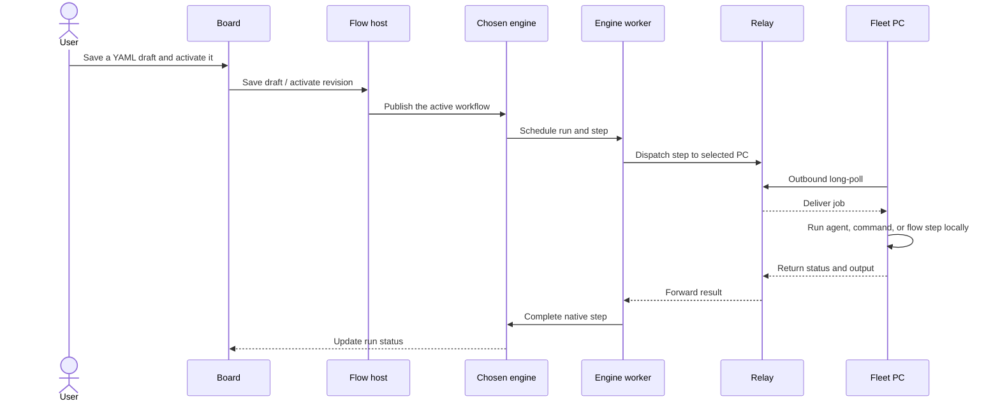

# Agent Orchestration

A shared control plane for self-hosted AI-agent work, built on top of Hatchet, Prefect, or Trigger.dev.

## The problem it solves

Workflow engines schedule jobs and manage retries, but teams still need a usable way to launch and follow coding agents, handle human interaction, build workflows, and route work to machines with the right tools or hardware. Those tasks otherwise end up split across engine dashboards, custom scripts, and one-off worker setups.

This project adds that shared layer without replacing the engines. The Board gives people one place to start and monitor work. A Fleet of registered PCs runs agents and commands near their tools, credentials, and devices. Portable YAML workflows can be activated on any of the supported engines.

## How the pieces fit

The engines own native scheduling and run state. The shared layer supplies the Board, flow host,
relay, and Fleet PCs that execute work locally.

```mermaid
flowchart LR
    User --> Board["Agent Board"]
    Board -->|"launch and inspect runs"| Engines["Hatchet · Prefect · Trigger.dev"]
    Board -->|"save drafts and activate flows"| Host["Flow host"]
    Host -->|"publish active YAML workflows"| Engines
    Engines -->|"schedule native runs"| Runners["Engine workers / coordinators"]
    Runners -->|"dispatch work"| Relay["Outbound relay"]
    PC["Registered Fleet PC"] -->|"outbound poll and results"| Relay
    Relay -->|"queued jobs"| PC
    PC --> Local["Local agents, commands, and devices"]
```



## What it adds above the engines

- **One Board:** create agent sessions, command cards, schedules, and workflows; watch live progress; answer questions and permissions; steer or stop runs.
- **Interactive coding-agent sessions:** connect ACP-compatible agents such as Codex, Claude Code, and OpenCode to the Board's chat, with approvals, interruption, and continuation.
- **Portable workflows:** author a YAML workflow once and activate it on Hatchet, Prefect, or Trigger.dev. The Board adds a visual editor and separates drafts from explicit activation.
- **A shared worker Fleet:** register Windows or Linux PCs once, then route work by engine, software, pool, tags, and capacity. Fleet workers connect outbound, so they need no inbound port.
- **Self-hosted and offline operation:** run the Board and engines yourself, or create a bundle for a network with no internet access.

The engines remain responsible for their native scheduling, retries, persistence, and run lifecycle. The shared flow format covers common workflow behavior; engine-specific features remain available through each engine's own APIs and UI.

## Why support three engines?

They solve related problems with different strengths. Supporting all three lets a team choose the engine that fits its language, reliability, interaction, hardware, and operations needs—without giving up the shared Board and Fleet. You can run one engine; the project does not require all three.

| Engine | Good fit when you need |
|---|---|
| [Hatchet](hatchet/README.md) | Durable task workflows, worker-label routing to hardware PCs, and straightforward offline operation. |
| [Prefect](prefect/README.md) | Python-native workflows, a lightweight server, and built-in approval forms for human input. |
| [Trigger.dev](trigger.dev/README.md) | TypeScript workflows, versioned deployments, and rich streaming/UI features. Its self-hosted run containers are less suited to local-device access and take more work to operate offline. |

See [COMPARISON.md](COMPARISON.md) for tested capabilities, limitations, and operational trade-offs.

## A portable workflow run



## Start online (Hatchet example)

Requirements: Docker Compose v2. Run these commands from Bash; on Windows, use Git Bash or WSL.
Windows Docker Desktop uses `;` instead of `:` to separate files in `COMPOSE_FILE`.

From the repository root:

```bash
cp .env.example .env
```

In `.env`, set a random `FLOW_HOST_TOKEN` and select Hatchet:

```dotenv
COMPOSE_PROFILES=hatchet
FLOW_BACKENDS=hatchet
ENGINES=hatchet
```

Start Hatchet and connect it to the shared Docker network:

```bash
cd hatchet
cp .env.example .env
```

In `hatchet/.env`, change the admin and Postgres passwords, keep `HATCHET_HOST=localhost` for a
single-machine setup, and set `COMPOSE_FILE=docker-compose.yml:docker-compose.agents.yml`
(`docker-compose.yml;docker-compose.agents.yml` on Windows Docker Desktop). Then run:

```bash
docker compose up -d
./scripts/create-token.sh
cd ..
cp board/.env.example board/.env
```

Copy `HATCHET_CLIENT_TOKEN` from `hatchet/.env` into `board/.env`. Set `BOARD_PASSWORD` before
making the Board reachable beyond localhost. From the repository root, start the Board and workers:

```bash
docker compose up -d --build
```

Open [http://localhost:8090](http://localhost:8090). In **Admin**, check that Hatchet is reachable;
in **Fleet → Register PC**, install a worker and then try the built-in `demo` agent. For Prefect or
Trigger.dev, start that engine separately and set its matching root `.env` selections and
`board/.env` credentials. The [engine comparison](COMPARISON.md) explains the differences.

## Run work

1. Start an engine using its guide above.
2. In **Fleet → Register PC**, create a worker install command and run it on the Windows or Linux PC that should execute the work. Node.js and npm are required for the pinned ACP adapters; real agents also need their CLI and provider credentials on that PC. See [worker installation and lifecycle](docs/workers-and-context.md#register-a-pc).
3. Create a coding-agent session, command card, or workflow in **New card**. The built-in `demo` agent is a no-credentials connectivity check.

For portable workflows, open **Flows** in the Board or read the [workflow guide](flows/README.md). Saved workflows are drafts; activation is a separate, explicit action.

## Work offline

Offline use has two stages: build a complete bundle on a connected machine, then load and run it
inside the isolated network. **Hatchet is the recommended first engine offline.**

### Build on a connected machine

From the repository root, create `.env`, set `FLOW_HOST_TOKEN`, and set `ENGINES=hatchet` for
the recommended Hatchet-only Board image. Then install the locked Trigger CLI dependencies and
build the bundle:

```bash
cp .env.example .env
npm ci --prefix trigger.dev/example-project
./offline/bundle.sh
```

On Windows, run `npm.cmd ci --prefix trigger.dev/example-project` in PowerShell, then run
`./offline/bundle.sh` from Git Bash or WSL.

The builder also needs the worker and runtime artifacts described in [OFFLINE.md](OFFLINE.md);
it stops with an error if any are missing. Transfer the entire `dist/offline-bundle/` directory to
the offline host. Do not copy `.env` files or credentials.

### Start on the offline host

Run from the transferred bundle directory (Git Bash or WSL on Windows):

```bash
./load.sh install /opt/agent_orchestration
```

This verifies the checksums, loads the images, unpacks the source and worker binaries, and starts
the local npm mirror on port `4873`. On the offline host:

1. Start Hatchet from `/opt/agent_orchestration/hatchet`. Copy `.env.example` to `.env`, set
   `HATCHET_HOST` to this host's offline-network name or IP, change the default passwords, and set
   `COMPOSE_FILE=docker-compose.yml:docker-compose.agents.yml` (`;` instead of `:` on Windows
   Docker Desktop). Run `docker compose up -d`, then `./scripts/create-token.sh`.
2. In `/opt/agent_orchestration`, copy `.env.example` to `.env` and set `FLOW_HOST_TOKEN`,
   `HATCHET_WORKER_CLIENT_TOKEN` from step 1, `COMPOSE_PROFILES=hatchet`, `FLOW_BACKENDS=hatchet`,
   and `ENGINES=hatchet`. Copy `board/.env.example` to `board/.env`; set `BOARD_PASSWORD`,
   `HATCHET_CLIENT_TOKEN` from step 1, and `HATCHET_DASHBOARD_URL=http://<server>:8080`. Then start from the repo root:

   ```bash
   docker compose --profile hatchet up -d --no-build
   ```

   `--no-build` makes Compose use only the images loaded from the bundle. In **Admin**, check
   Hatchet with API URL `http://hatchet-dashboard:80` and dashboard URL `http://<server>:8080`.
3. Make sure Node.js and npm are on the worker account's `PATH`. If they are not, copy the matching
   archive from `dist/offline-bundle/worker-tools/` and follow the platform instructions in the
   [offline guide](OFFLINE.md#offline-side-hatchet-board-and-a-fleet-worker). Point npm at the mirror:

   ```bash
   npm config set registry 'http://<server>:4873/'
   ```

   In Windows PowerShell, use `npm.cmd` instead of `npm`. Then register the PC in **Fleet** and run
   the generated command.

The worker PC and server need to reach each other on the offline network; neither needs public
Internet access. The `demo` agent checks the route without provider credentials. See
[OFFLINE.md](OFFLINE.md) for prerequisites, bundling, transfer, and troubleshooting.

## Repository map

| Path | Purpose |
|---|---|
| [`board/`](board/README.md) | Web Board, cards, chat, Fleet, and workflow builder |
| [`agents/`](agents/README.md) | Coding-agent sessions, worker services, and execution adapters |
| [`flows/`](flows/README.md) | Portable YAML workflows and examples |
| [`hatchet/`](hatchet/README.md) | Hatchet example stack |
| [`prefect/`](prefect/README.md) | Prefect example stack |
| [`trigger.dev/`](trigger.dev/README.md) | Trigger.dev example stack |
| [`offline/`](OFFLINE.md) | Offline bundle and deployment instructions |
| [`COMPARISON.md`](COMPARISON.md) | Engine capabilities and trade-offs |

The [worker guide](docs/workers-and-context.md) covers Fleet setup, identity, updates, and troubleshooting. Each component README has detailed configuration and verification steps.
